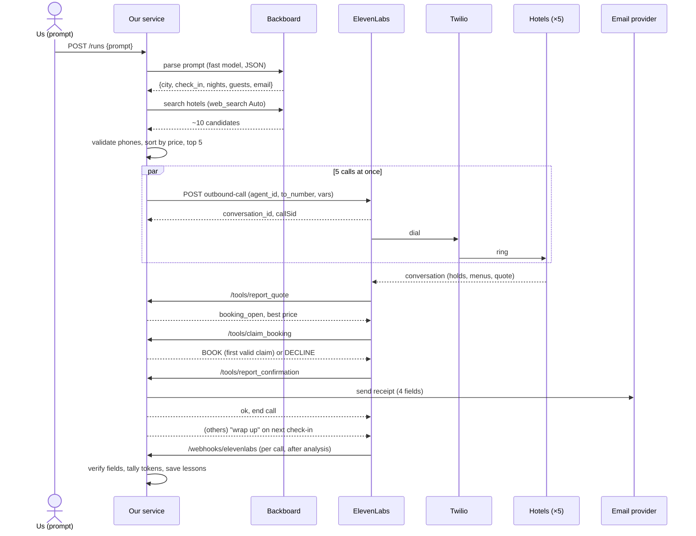

# Run Workflow

The end-to-end path of one run: a text prompt comes in, a confirmation email goes out. This doc covers the stages, the services and which one handles what. Agent settings, the token tally and the suggested test runs are in [architecture-plan.md](architecture-plan.md). The background research is in [the field guide](../research/elevenlabs-backboard-field-guide.html).

## At a Glance

1. **Prompt.** We type a request; our service creates a run.
2. **Parse.** Backboard turns the text into structured inputs: city, dates, guests, email.
3. **Search and rank.** Backboard web search finds candidate hotels. Our code picks the 5 cheapest that have a valid phone number.
4. **Dial.** Our service starts all 5 calls at once through the ElevenLabs API, all using our one `agent_id`.
5. **Calls.** ElevenLabs and Twilio hold the conversations. At fixed points the agent checks in with our API, and we answer from the state we keep in memory.
6. **Email.** On the first confirmed booking, our service emails the receipt. The race clock stops here.
7. **Settle.** The other calls end, and post-call webhooks let us double-check the email.
8. **Tally and lessons.** We sum tokens and cost, and save lessons for the next run.

## Services and What They Own

| Service | Runs where | Owns | Called by / calls |
|---|---|---|---|
| **Our service** (orchestrator) | One Python + FastAPI process, `--workers 1`, on our machine behind an HTTPS tunnel | Run state, booking lock, ranking, dialing, email trigger, ledger | Called by us (`/runs`) and ElevenLabs (`/tools/*`, `/webhooks/*`). Calls Backboard, ElevenLabs, Twilio and email. |
| **Backboard** | Cloud API (`app.backboard.io/api`) | Prompt parsing, hotel web search, optional transcript check, lessons memory | Called by our service only |
| **ElevenLabs Agents** | Cloud | Agent config (`agent_id`: prompt, voice, tools, turn settings); runs every conversation; post-call data and usage | Called by our service (start calls, fetch usage). Calls our tool URLs during calls and our webhook after. |
| **Twilio** | Cloud | Phone number and phone network; call price; hang-up control | Used by ElevenLabs to dial; our service uses it to hang up stragglers |
| **Email provider** (Resend, SendGrid or SMTP; TBD) | Cloud | Delivering the receipt | Called by our service |
| **Tunnel** (cloudflared named tunnel) | Our machine + cloud edge | A stable public HTTPS URL that forwards to `localhost` | ElevenLabs reaches our service through it |

Only our service holds run state. Every other service is stateless from our point of view, or keeps only its own records (call logs, usage).

## Sequence



## Stage by Stage

### Stage 0 · Always On (before the prompt)

These are ready before anyone types a prompt:
- The ElevenLabs agent exists with its tools pointing at our tunnel URL.
- The Twilio number is imported into ElevenLabs.
- Our service and the tunnel are running.

A pre-flight check confirms `GET /health` answers through the public URL and that the ElevenLabs, Twilio, Backboard and email keys all work. Nothing is created by hand once the run starts.

### Stage 1 · Prompt → Run

- **Owner:** our service (run API).
- **Trigger:** a free-text prompt sent from a small CLI:

```bash
python start.py "Book the cheapest hotel in Toronto for Oct 24, one night, two adults. Email the confirmation to receipts@example.com"
```

- `start.py` sends `POST /runs {"prompt": "..."}` with our secret header and prints progress by polling `GET /runs/{id}`.
- The service creates a `run_id`, records `t0` (the race clock starts), and opens `runs/<run_id>/ledger.jsonl`.

### Stage 2 · Parse

- **Owner:** our service, calling Backboard.
- **How:** one Backboard message to a fast model with `json_output: true` and no web search. JSON output works only when web search is off. It extracts `{city, check_in (ISO date), nights, guests, rooms, email, max_price?, notes?}`.
- **Our code validates the result:**
  - The email matches a valid format.
  - The date is today or later.
  - Defaults apply: 1 night, 1 room.
- **Missing city, date or email:** fail fast with a clear message. A run with no email can't score.
- **Logged:** tokens and duration go to the ledger.

### Stage 3 · Search and Rank

- **Owner:** Backboard (search), our service (ranking).
- **Search:** one Backboard message with `web_search: "Auto"`. It asks for the ~10 cheapest hotels in the city for those dates, each with name, nightly price, currency, phone, street address and source. Web search ignores `json_output`, so the prompt asks for a JSON array and our code parses it. If parsing fails, one reformat call (no web search, `json_output: true`) fixes it.
- **Ranking, in our code:**
  - Normalize phones to E.164 and drop entries without a valid number.
  - Dedupe by phone.
  - Sort by price.
  - The **top 5 are wave 1**; the rest stay in **reserve**.
- **Kept on each candidate:** the street address, as a fallback for the email if the call doesn't capture it.
- **Search prices are estimates.** The price that counts is the one the receptionist quotes.

### Stage 4 · Dial

- **Owner:** our service, calling ElevenLabs.
- **How:** 5 `POST /v1/convai/twilio/outbound-call` requests fired together with `asyncio.gather`. All 5 use the same `agent_id` and `agent_phone_number_id`; each has its own `to_number` and dynamic variables (`run_id`, `candidate_id`, `hotel_name`, `listed_price`, `check_in`, `nights`, `guests`, `guest_name`, `payment_policy`, `hotel_notes`).
- **Result:** each request returns within about a second with `conversation_id` and `callSid`. Both go on the board, and the call's status becomes `ringing`.
- **After dialing,** our service doesn't drive the calls. It waits for check-ins.

### Stage 5 · Calls, with Check-ins

- **Owner:** ElevenLabs (conversation) + Twilio (line). Our service answers the check-ins.
- **ElevenLabs handles on its own:** ringing, phone menus (`play_keypad_touch_tone`), holds (`skip_turn`), voicemail (`voicemail_detection`), the conversation itself, and hanging up (`end_call`).
- **Check-ins.** At set points the agent's LLM calls a webhook tool. ElevenLabs sends an HTTPS POST to our tool URL, waits for the JSON reply, and the agent acts on it:

| Check-in | Point in the call | Our service does (in memory + ledger) | Reply |
|---|---|---|---|
| `report_quote(price, available)` | Hotel gave a rate | Save the quote on the board | `booking_open`, best price seen |
| `claim_booking(price)` | About to say "yes, book it" | **This is the confirm-or-not step.** Take the lock; the first valid claim at or under the ceiling wins | `BOOK`, or `DECLINE` + a polite line |
| `check_status()` | While waiting or on hold | Read the board | Keep going / wrap up |
| `report_confirmation(conf, price, dates, address)` | Hotel gave a confirmation number and the agent read it back | Check the 4 fields; trigger the email (Stage 6) | `ok`, or "ask for X" if a field is missing |

- **Board state per call:** `ringing → talking → quoted → claimed | declined → booked | ended | no_answer`.
- **The board is a dict in our process.** Every change also goes to the ledger, so a crash can be replayed.
- **Calls only learn things when they check in.** A losing call finds out on its next check-in, so the prompt makes it check in at those fixed points.

### Stage 6 · Email

- **Owner:** our service, calling the email provider.
- **When:** at the **first `report_confirmation`**, before that call hangs up. With the booking lock, only one call can get there.
- **The handler:**
  1. **Checks** all 4 required fields: confirmation number, price, date, hotel address. The address falls back to the search result if the call didn't capture it.
  2. **If one is missing,** replies "ask for the confirmation number again" (or whichever field) and doesn't send yet.
  3. **Sends the email in the background**, so the agent's tool call returns at once, and records `t_email`. That timestamp is our race time.
  4. **Moves the run to `EMAILED`.** The other calls get "wrap up" on their next check-in. After a 30 s grace period, any straggler is hung up through Twilio using its `callSid`.
- **Why here and not after the call:** the post-call webhook arrives only after ElevenLabs finishes analysis, which can be minutes later. Waiting for it would add that time to our score.

### Stage 7 · Settle and Verify

- **Owner:** our service. ElevenLabs sends the data.
- **How:** each call's post-call webhook hits `POST /webhooks/elevenlabs`. We verify the HMAC signature, then compare `data_collection_results` with what we emailed.
- **On a mismatch,** for example a misheard digit, send a corrected email and log it.
- **Optional:** a Backboard pass over the winning transcript as a second check.
- **Our clock still stops at `t_email`;** this stage doesn't affect race time.

### Stage 8 · Tally and Lessons

- **Owner:** our service, using Backboard, ElevenLabs and Twilio usage data.
- **Tally:** when all 5 conversations report `done`, the service writes `runs/<run_id>/report.md` with tokens, cost and stage timings. See [Token and Cost Tally](architecture-plan.md#token-and-cost-tally).
- **Lessons (optional):** per-hotel facts are written to Backboard memory, e.g. "press 2 for reservations, holds ~40 s, asks for a card". The next run reads them into `hotel_notes`.

## Run States

`RECEIVED → PARSED → SEARCHED → DIALING → IN_CALLS → BOOKED → EMAILED → SETTLING → DONE`, or `FAILED` from any state, with a reason.

## Failure Paths

| What goes wrong | What the service does |
|---|---|
| Prompt is missing city, date or email | Fail at Stage 2 with a clear message |
| Fewer than 5 usable hotels | Dial what we have |
| A call fails to start (`call_initiation_failure` or an API error) | Mark it failed and dial the next reserve hotel straight away |
| All of wave 1 end with no booking | Dial the next 5 from reserve |
| Overall timeout (e.g. 12 min) | Stop dialing, end calls, report failure |
| Service crashes | Restart and rebuild the board from the ledger |

## Endpoints on Our Service

| Endpoint | Called by | When | Auth |
|---|---|---|---|
| `GET /health` | Us | Pre-flight | none |
| `POST /runs` | `start.py` (us) | Start of a run | Secret header |
| `GET /runs/{id}` | `start.py` (us) | Progress and result | Secret header |
| `POST /tools/report_quote` | ElevenLabs | Mid-call | Secret header |
| `POST /tools/claim_booking` | ElevenLabs | Mid-call | Secret header |
| `POST /tools/check_status` | ElevenLabs | Mid-call | Secret header |
| `POST /tools/report_confirmation` | ElevenLabs | Mid-call | Secret header |
| `POST /webhooks/elevenlabs` | ElevenLabs | After each call | HMAC signature |

## Network

- **ElevenLabs must reach us at a public URL.** It sends the mid-call tool requests from its own servers, and the post-call webhook too. Starting calls needs nothing public, since we call them.
- **Use HTTPS.** The service listens on plain HTTP on `localhost`; the cloudflared tunnel gives it a public `https://` URL. HTTPS protects the secret header, guest details and transcripts in transit.
- **Use a named tunnel.** The tool URLs are saved in the agent config, so the public URL must not change between restarts.
- **Run one worker.** The board and lock live in one process's memory; several workers would each have their own copy.

## Timing Targets

These are guesses to measure in the test runs, not results.

| Stage | Target |
|---|---|
| Parse | 1–2 s |
| Search and rank | 10–20 s |
| Dial (all 5) | < 2 s |
| Ringing to answer | 5–25 s (ringing timeout 25 s) |
| Call to confirmation | 2–5 min |
| Email send | < 2 s |

## Who Handles What

| Concern | Handled by |
|---|---|
| Understanding the prompt | Backboard (LLM) + our validation |
| Finding hotels | Backboard (web search) |
| Choosing the 5 | Our service |
| Placing calls | Our service → ElevenLabs API |
| Phone line | Twilio |
| Talking, holds, menus, voicemail | ElevenLabs agent |
| Deciding who books | Our service (booking lock) |
| Remembering run state | Our service (memory + ledger) |
| Sending the receipt | Our service → email provider |
| Checking the receipt afterwards | Our service (post-call webhook), optionally Backboard |
| Token and cost report | Our service (ledger + usage APIs) |
| Lessons across runs | Backboard memory |
